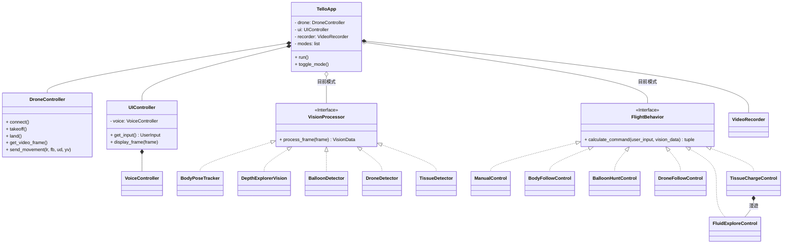

# Tello EDU 自主飛行專案

以 DJI Tello EDU 為平台的視覺自主飛行實驗專案。電腦端負責所有運算 (YOLO 偵測、單目深度、語音辨識)，
無人機只回傳影像、接收 rc 速度指令。除了鍵盤 / 語音手動操作，還有手勢跟隨、深度漫遊避障、
氣球獵手、無人機跟隨、衛生紙條衝撞等自動模式，用 `Z` 鍵依序切換。

## 飛行模式

| 模式 | 做什麼 | 視覺模組 | 使用的權重 |
|---|---|---|---|
| MANUAL CONTROL | 鍵盤 + 離線語音指令手動操作 | 無 | — |
| HAND TRACKER | 跟隨人 (胸腔鎖定 / 手部指揮)，可環繞 | `vision/pose_tracker.py` | `yolo_pose_collect/yolo26n-pose.pt` |
| FLUID EXPLORER | 單目深度漫遊避障 (遇到障礙往比較空的一側轉隨機角度，不後退) | `vision/fluid_explorer_vision.py` | `yolo_depth_collect/yolo26n-depth.pt` |
| BALLOON HUNT | 依編號搜尋並攻擊氣球 (ArUco 標籤補償) | `vision/balloon_detector_with_aruco.py` | `yolo_ballon_collect/best.pt` + 深度 |
| DRONE FOLLOW | 跟隨另一台無人機 | `vision/drone_detector.py` | `yolo_drone_collect/epoch30.pt` |
| TISSUE CHARGE | 漫遊找天花板垂下的衛生紙條並衝撞 (可選白色 / 彩色) | `vision/tissue_detector.py` | `yolo_tissue_collect/best.pt` + 深度 |

權重路徑都在 `model/yolo26/runs/detect/` 底下，已經放在 repo 裡，clone 下來就能用 (見[模型權重](#模型權重))。

## 環境需求

- **無人機**：DJI Tello EDU (一般版 Tello 也能飛，但沒有測過)
- **電腦**：Linux (開發環境為 Ubuntu)，建議有 NVIDIA 顯示卡
  - 開發機：RTX 3050 Ti Laptop、CUDA 13.0、torch 2.14.0+cu130
  - 沒有 GPU 也能執行，但深度推論太慢，漫遊類的模式無法安全飛行
- **Python**：3.10 (conda 環境名稱 `UAV`)
- **選用**：麥克風 + `arecord` (alsa-utils，Ubuntu 通常已內建) 才能用語音指令

## 安裝

```bash
git clone git@github.com:superdoro/tello-edu-project.git
cd tello-edu-project

# 1. 建立 conda 環境 (含 CUDA 13.0 版的 torch)
conda env create -f environment.yml
conda activate UAV
```

顯示卡驅動不支援 CUDA 13 的話，把 `environment.yml` 裡的 `cu130` 改成對應版本 (例如 `cu126`)，
並把 `requirements.txt` 的 torch / torchvision 改成該版本有提供的版號。
想手動安裝的話，步驟寫在 `requirements.txt` 的檔頭。

```bash
# 2. (選用) 離線語音：下載 Vosk 中文小模型 (42MB，解開後 66MB，沒有放進 repo)
curl -LO https://alphacephei.com/vosk/models/vosk-model-small-cn-0.22.zip
unzip vosk-model-small-cn-0.22.zip -d model/vosk/

# 3. (選用) 身分辨識：在有網路的環境預先下載人臉模型權重
python utils/identity_warmup.py
```

第 3 步一定要在連 Tello 之前做：飛行時電腦連的是 Tello 的 Wi-Fi，沒有外網，
臨時下載權重會卡住主迴圈，Tello 約 15 秒收不到指令就會自動降落。

## 執行

1. 開啟 Tello 電源，電腦連上 `TELLO-XXXXXX` Wi-Fi
2. 啟動程式：

   ```bash
   conda activate UAV
   python main.py
   ```

3. 程式會連線、開啟影像串流，視窗出現畫面後按 `T` 起飛

## 操作

| 按鍵 | 動作 |
|---|---|
| `T` / `L` | 起飛 / 降落 |
| `Q` | 降落並結束程式 |
| `↑` `↓` `←` `→` | 前進 / 後退 / 左移 / 右移 |
| `W` / `S` | 上升 / 下降 |
| `A` / `D` | 機頭左轉 / 右轉 |
| `Z` | 切換飛行模式 (依上表順序循環) |
| `V` | 開始 / 停止錄影 (見[錄影與飛行紀錄](#錄影與飛行紀錄)) |
| `F` | 模式專用：HAND TRACKER 切換「胸腔鎖定 / 手部指揮」；TISSUE CHARGE 顯示被擋掉的偵測 |
| `R` | 模式專用：HAND TRACKER 循環鎖定畫面中的人；TISSUE CHARGE 放棄目前鎖定的紙條 |
| `O` | HAND TRACKER 環繞：關閉 → 逆時針 → 順時針 → 關閉 |
| `C` | TISSUE CHARGE 切換要撞的紙條：全白 ↔ 彩色 (預設全白) |

- 任何自動模式中按方向鍵都會立刻接管，放開後交還自動控制。
- HAND TRACKER 環繞時會自動拉近距離；切換飛行模式時會自動關閉環繞。

### 語音指令

離線辨識 (Vosk 中文小模型)，飛行時不需要網路。說「喚醒詞 + 指令」，例如「無人機起飛」。

**喚醒詞** (必須先講，避免閒聊誤觸發)

```
無人機   <- 建議用這個，實測最穩
小白 / 悟空 / 飛機 / 阿飛 / tello
```

⚠️ 舊版的「泰羅」實測會被聽成「嗨哦」—— 這個模型認不出自創的名字，請改用上面的喚醒詞。

**指令** (括號內是實測最抗噪的說法，噪音大時請優先用它)

```
起飛    起飛 / take off
降落    降落 / 著陸 / land
前進    前進 / 往前 / 向前
後退   （往後）/ 後退 / 向後       <- 「後退」會被聽成「后错误」，請說「往後」
向左   （左轉）/ 往左 / 左邊       <- 「往左」在噪音下會變成「王所」
向右   （往右）/ 右轉 / 右邊
上升   （升高）/ 上升              <- 「往上」會被聽成「网上」，不要用
下降    下降 / 降低 / 往下
轉向   （轉身）/ 轉向 / 旋轉
停止    停止 / 停下
切換    切換模式 / switch
```

**抗噪實測** (`python utils/voice_bench.py`，混入合成的四旋翼噪音)

```
訊噪比      正確率    認錯指令   誤觸發
乾淨        100%       0        0
20dB       100%       0        0
15dB       100%       0        0
10dB       100%       0        0
 5dB        69%       0        0
 0dB         0%       0        0
```

所有噪音等級下都**沒有認錯指令、也沒有誤觸發** —— 失效方式一律是「沒反應」，
不會把「左」聽成「右」。噪音太大時叫不動，但不會亂飛。

起飛、降落、切換模式會直接觸發對應動作；方向指令交給 ManualControl，持續飛 1.5 秒後自動停止 (`VOICE_DURATION_SEC`)。
任何鍵盤輸入都會立刻蓋過語音。畫面左下角會顯示最近聽到的話，方便確認麥克風有在收音。
沒有麥克風、或沒下載模型時語音會自動停用，其餘功能不受影響。

## TISSUE CHARGE (衛生紙條衝撞) 使用說明

流程：`SEARCH` 漫遊找紙條 → `TRACK` 對準並逼近 → `COAST` 紙條貼到眼前看不見時再滑行一小段 → `BACKOFF` 退開 → 回到漫遊。

- **不論顏色先靠近，夠近才判斷顏色**：遠處的紙條只有幾個像素寬，條紋會被壓縮雜訊糊掉，顏色常判錯。
  所以估距超過 80cm 時不判斷，看到就先對準飛過去 (畫面標白框 `APPROACH 120cm`，狀態列 `TISSUE: APPROACH d120cm`)，
  130cm 內放慢，進到 80cm 停住、只轉機頭對準，畫面中央顯示 `CHECKING TARGET` (狀態列 `JUDGING`)，等投票結果：
  - 是目標 → 照常衝。
  - 不是目標 → 往旁邊平移繞過去 (`AVOID NON-TARGET`，見下面「不該撞的紙條會繞開」)，
    接下來 3 秒不再接近還沒判斷的紙條，讓漫遊把無人機帶開。
  - 看了 2.5 秒還判斷不出來、或判斷中跟丟超過 0.5 秒 → 放棄這條：在正前方就一樣平移繞過去，不在中間就直接回漫遊。
  - 還沒判斷的紙條絕不會滑行 (`COAST`) 衝過去。
  遠處還沒判斷的紙條不會被當成「不該撞」而閃避、也不會觸發視差繞路 (`PARALLAX CHECK` / `DETOUR`)。
  門檻在 `TissueDetector.JUDGE_DIST_CM` / `JUDGE_KEEP_CM` 與 `TissueChargeControl.JUDGE_*`。
- **估距 = 紙條的厚度**：紙條實寬 3cm，量 YOLO 分割輪廓「垂直於紙條方向」有幾個像素就能換算距離
  (用原生 960x720 畫面量，再取同一條紙條最近 0.4 秒的中位數)。試過的其他量法都不準 (10/20 錄影)：
  - 框寬：紙條斜掛、晃動時框寬好幾倍 —— 約 1 公尺的紙條框寬估成 16–22cm，觸發了對空氣的滑行。
  - 輪廓面積：取決於 YOLO 切出多長一段，同一條紙條「整條」與「只切到上半段」差 3 倍。
  - 深度模型：看不到細紙條，量到的是後面的牆。
  所有用到距離的地方 (判斷顏色、接近速度、`COAST` 滑行、機身會掃到的範圍、繞開的餘裕、視差) 都用這個估距。
  log 的 `dist` 是估距、`sw` 是紙條厚度 (px)、`tw` 是框寬 (對照用)。
  離線檢查估距：`python tests/replay_tissue.py track recordings/<時間>_TISSUE_CHARGE_raw.mp4 --from 50 --to 56`。
- **畫面邊緣的近距離大框不當紙條**：碰到畫面左右邊緣、一出現估距就不到 25cm 的框 (多半是門框、牆角)
  會被擋掉 (按 `F` 時標橘色 `EDGE`，狀態列 `edge N`)；一路追近的那條近到碰邊不受影響。
- **模型**：`best.pt` (yolo26s-seg，單一類別 `tissue`)。程式預設把模型的所有類別都當成紙條收下，
  換成多類別模型 (例如試過的 `paper_two_class_20261019_hard_v2.pt`：`paper_plain` / `paper_red_marked`)
  不用改程式，顏色一樣由驗證器在近距離判斷；類別名稱記在 log 的 `cls` 欄位。
  只想收某一類時用 `TissueDetector(tissue_class_ids=0)`。

- **高度鎖定**：這個模式不會自動改變高度，只有按 `W` / `S` 才會升降。
  請先手動飛到紙條尖端附近的高度，再按 `Z` 切進這個模式。
  Tello 回報的高度讀值會隨起飛點、下方的桌櫃改變，不可靠，所以程式完全不使用它。
- **紅點 = 前進路線**：畫面上的紅點在畫面高度 75% 的位置 (Tello 鏡頭略朝下，往前飛時機身前傾，
  真正飛過去的那一列在畫面中心上方)。紙條有橫過紅點那一列才會往前衝；
  整條在上方或下方超過 1 秒就放棄換下一條 —— 一直看到「紙條整條在前進路線上方」就是高度太低，用 `W` 調高。
- **白牆判定**：純白、沒有紋理的柱子或牆面，單目深度模型會誤判成很遠。
  畫面中「從頂端一路白到底端」的區域會被當成近距離障礙 (畫面上標 `WHITE WALL`)，漫遊會轉開。
- **撞白色或彩色** (`C` 鍵切換，預設全白)：畫面左下角狀態列開頭的 `[WHITE]` / `[COLOR]` 是目前的目標。
  「有顏色的紙條」指紙條上有一段以上的彩色條紋 (例如白色衛生紙畫上幾段紫色)，整條都是彩色的也算。
  - 白色模式只撞完全沒有彩色條紋的紙條；鎖定之後仍持續檢查，靠近時才看清楚條紋的也會取消鎖定。
    取消鎖定時如果正在衝，不會滑行 (`COAST`) 過去，紙條在正前方就平移繞開。
  - 確認成白的要更嚴：投票的 5 格裡只要有一格看到彩色就不確認 (白紙條在校正資料裡從來沒被當成彩色)；
    被畫面左右邊緣切掉一截的紙條先不判斷 (看不到的那一截可能是條紋)，等機頭轉過去再判斷。
  - 近距離時條紋會把白色切成好幾段 (白色驗證器說「形狀不像紙條」)，紙條輪廓裡看得到彩色就一樣算有色紙條。
  - 彩色模式只撞有彩色條紋的紙條；純白紙條、多色的畫或海報、只有背景有顏色的都不算。
  - 顏色只看 YOLO 分割輪廓內的紙條像素，紙條扭轉、彎曲或後面是彩色櫃子都不受影響。
  - **不該撞的紙條會繞開**：顏色不符的紙條標洋紅色 `AVOID`，畫面頂端出現洋紅色橫幅。
    只有**在中間** (正前方、機身會掃到：橫過紅點那一列、250cm 內) 的才會反應，**不在中間的完全不理**。
    **畫面兩旁的也不理**：畫面分三等分，紙條中心在左右兩份的不閃、不繞、不出橫幅 (標細的洋紅框 `side`)。
    1/3 寬 = 離中央 120px，60cm 處約 16cm，比機身半寬還寬；40cm 以內才可能擦到護罩。
    範圍在 `TissueDetector.AVOID_SIDE_RATIO`。
    在中間的：機頭不動、**往旁邊平移** (畫面中央顯示 `AVOID NON-TARGET`)，紙條一離開機身會掃到的範圍
    (機身半寬 12cm + 紙條半寬 + 至少 8cm 餘裕) 就交還漫遊、照原本的方向往前，從紙條旁邊飛過去。不後退。
    - 往哪邊：左右深度差 1.2 倍以上 → 往比較空的一側；差不多 → 往離紙條比較遠的一側 (路比較短)。
    - 兩側深度都低於 150cm (平移過去也是牆)、或平移 2.5 秒還繞不開 → 改成原地往同一側轉 35°–75°，
      轉完 2 秒內不再觸發，接下來 5 秒漫遊轉彎時優先往同一側。
    - 平移中紙條看不到了 → 至少平移 1 秒 (約 25cm) 才交還。
    深度模型看不到細細的紙條，所以這是另外加上的。
  - **要有正面證據才算有色紙條**：白色模式下「不夠白」還要在紙條輪廓裡真的看到彩色才閃；
    彩色模式下「沒顏色」也要白色驗證器確認是白的才閃。只有背景有顏色的 (紙條本身沒有) 會標
    `NOT-WHITE col?` (或 `white?`)，不撞也不閃。
    被否決的紙條看不到超過 3 秒就忘掉，轉頭之後掃過同一個畫面位置的白紙條不會被誤當成剛剛那條有色紙條。
  - **非白紙條擋在白紙條的路線上時，用運動視差判斷前後**：無人機先往旁邊平移約 16 公分，
    近的紙條在畫面上移動得多、遠的移動得少。非白紙條在後面而且離得夠遠就直接衝白紙條；
    在前面、在後面但太近、或看不出前後，就繼續往同一側繞 (同時轉機頭對準白紙條)，
    分得夠開再衝。繞了 4 秒還分不開才放棄這條白紙條 (非白紙條在中間就照上面的方式繞開)。
    畫面中央會顯示 `PARALLAX CHECK` / `DETOUR AROUND NON-TARGET`，
    log 的 `parallax` 欄位記錄判斷結果。
  - 漫遊時如果畫面裡有紙條正在確認 (可能是白紙條)，而非白紙條不是近在眼前，會先停住最多 0.6 秒等結果，不急著避開。
  - 切換 `C` 時會清掉所有投票與鎖定，用新的標準重新判斷。
  - 門檻 (`utils/colour_strip.py`) 是用 10/20 五趟錄影、判斷距離內人工標記的 101 個偵測校正的：
    很多條紋是淡紫色麥克筆斜線，飽和度只有 40~60，所以彩色像素的飽和度門檻是 40 (舊的 70 每格只抓到 54%
    的條紋紙條，現在 89%)，白紙條 0/31 被當成彩色。黑斑紙條 (偏棕色) 也算有色。
    白色驗證器把飽和度 40 以下算白，兩邊的門檻是接在一起的 —— 換到偏暖光源的場地，請先錄影重新校正。
- `F` 顯示被擋掉的偵測 (灰色 = 信心不足、橘色 = 形狀不符)，現場調門檻時用；
  `R` 放棄目前鎖定的紙條並暫時列入黑名單。

## 錄影與飛行紀錄

按 `V` 開始 / 停止錄影，`recordings/` 底下會產生三到四個同名檔案 (資料夾不進版控)：

| 檔案 | 內容 |
|---|---|
| `<時間>_<模式>_raw.mp4` | 乾淨畫面 (720x480，與 YOLO 推論看到的一致)，可拿來標註訓練資料 |
| `<時間>_<模式>_annotated.mp4` | 與螢幕上看到的一樣 (偵測框、深度、狀態)，用來找問題 |
| `<時間>_<模式>_native.mp4` | Tello 原生解析度 (960x720) 的乾淨畫面。TISSUE CHARGE 的 YOLO 吃的是這個，離線重播、訓練用它才一致 |
| `<時間>_<模式>_log.csv` | 每一格的模式、狀態、送出的 `lr/fb/ud/yv`、電量、高度讀值，以及各模式的診斷欄位 |

影片以固定 30fps、依實際時間排列，所以影格編號 ÷ 30 就是 CSV 的 `elapsed`，兩邊可以直接對照。
TISSUE CHARGE 的診斷欄位包含 `tw` (紙條框寬)、`bottom_y`、`cy`、`err_x/err_y` (十字與紅點的差距)、
`depth_ahead`、`blank` (白牆判定)、`target` (當時要撞白色還是彩色)、`avoid` (擋在前進路線上、不該撞的紙條最近幾公分)、
`judged` (0 = 還沒判斷，接近中或判斷中)、`sw` (紙條厚度 px，`dist` 就是用它換算的)、`cls` (模型類別) 等，欄位清單見 `utils/video_recorder.py` 的 `LOG_FIELDS`。

## 模型權重

都放在 `model/yolo26/runs/detect/`：

| 權重 | 大小 | 用途 |
|---|---|---|
| `yolo_tissue_collect/best.pt` | 22 MB | TISSUE CHARGE 紙條偵測 (分割) |
| `yolo_depth_collect/yolo26n-depth.pt` | 12 MB | 單目深度 (FLUID EXPLORER、BALLOON HUNT、TISSUE CHARGE) |
| `yolo_pose_collect/yolo26n-pose.pt` | 7.5 MB | HAND TRACKER 人體姿態 |
| `yolo_ballon_collect/best.pt` | 5.1 MB | BALLOON HUNT 氣球偵測 |
| `yolo_drone_collect/epoch30.pt` | 57 MB | DRONE FOLLOW 無人機偵測 |

repo 裡另外還有幾個目前程式沒有載入的權重 (`yolo_drone_collect/best.pt`、`yolo_pose_collect/yolo26s-pose.pt`、
`yolo_ballon_collect/best2.pt`、`yolo_tissue_collect/best_seg.pt` (前一版紙條模型)、`paper_two_class_20261019_hard_v2.pt` (試過的兩類別紙條模型)、`yolo_digit_collect/best.pt`)，以及訓練用的基底 `model/yolo26/yolo26n.pt`。
訓練中途的 `epoch*.pt` checkpoint 不進版控 (`.gitignore`)，只有 DRONE FOLLOW 正在用的 `epoch30.pt` 例外。

重新訓練：`model/yolo26/train_yoly.py`。

## 測試與離線工具

不需要無人機就能跑：

```bash
# TISSUE CHARGE 狀態機、高度鎖定、白牆判定、指令看門狗的行為測試
python tests/test_tissue_charge.py

# 用錄影檔重播紙條偵測與追蹤邏輯，調門檻不必起飛
python tests/replay_tissue.py dump  recordings/<時間>_TISSUE_CHARGE_raw.mp4
python tests/replay_tissue.py sweep <dump.json> --fp 60-67 --true 8-20,75-85
python tests/replay_tissue.py fsm   recordings/<時間>_TISSUE_CHARGE_raw.mp4 --log recordings/<時間>_TISSUE_CHARGE_log.csv

# 自動標註的測試 (追蹤、插值、選格、輪廓、匯出)
python tests/test_autolabel.py
```

### 從錄影的辨識失敗畫面產生 YOLO-seg 資料集

`model/yolo26/autolabel_tissue.py` 會從錄影裡挑出 `best.pt` 辨識失敗的畫面並自動標註 (單類別 `tissue`)，用來微調紙條模型：

- **漏抓**：同一條紙條前後幾格有高信心偵測，中間信心 < 0.5 或沒抓到 (中間空 0.5 秒內就插值補框)，
  用 SAM 以框當提示切出輪廓 (第一次會自動下載 `model/sam/sam2.1_b.pt`，約 160MB)。
- **誤抓**：信心 ≥ 0.5 但形狀不像紙條 (又寬又矮、框太寬) 的框，整個當背景，成為負樣本。
- **錨點**：另外抽一些本來就抓得很好的畫面 (最多佔失敗樣本 20%)，避免微調之後原本會的退步。
- 一張圖必須把每一條紙條都標到才收：畫面裡只要有判斷不出來的框 (信心 ≥ 0.25)，整格就不收。

```bash
# 1. 挑畫面 + 自動標註 (用 _native.mp4，960x720 與實飛 YOLO 的輸入一致)
python model/yolo26/autolabel_tissue.py mine recordings/<時間>_TISSUE_CHARGE_native.mp4 [...]
# (可選) 隨機抽 24 張畫成接觸表，先看標註品質 -> datasets/tissue_autolabel/sheet.jpg
python model/yolo26/autolabel_tissue.py sheet
# 2. 人工檢查：d / → / 空白 = 留，x = 丟，a / ← = 上一張，q = 存檔離開；滑鼠點實例切換 tissue <-> 背景
python model/yolo26/autolabel_tissue.py review
# 3. 匯出 (只匯出看過而且留下的；train / val 依「影片 + 10 秒區段」切，約 20% 當 val)
python model/yolo26/autolabel_tissue.py export --out datasets/tissue_real
# 4. 拿 best.pt 接著微調
yolo segment train model=model/yolo26/runs/detect/yolo_tissue_collect/best.pt \
    data=datasets/tissue_real/data.yaml imgsz=960 epochs=40 batch=4 lr0=0.002 name=tissue_real_ft
```

檢查畫面上：綠色 = YOLO 自己的輪廓、黃色 = SAM 補的、青色 = YOLO 低信心輪廓、紅框 = 當背景。
`review` 中斷後再開會從沒看過的那張接著看 (`datasets/tissue_autolabel/review.json`)。
原本訓練 `best.pt` 的合成資料集不在這台電腦上，這份資料集只有實景的困難樣本，
微調後請先用 `tests/replay_tissue.py` 在錄影上比較過，再取代 `best.pt`。
`datasets/` 與 `model/sam/` 不進版控。

| 工具 | 用途 |
|---|---|
| `utils/voice_bench.py` | 語音指令抗噪測試 (需要 `pip install gTTS av`，首次需要網路) |
| `utils/voice_tolerance.py` | 產生語音指令的噪音容忍表 |
| `utils/identity_bench.py` | 身分辨識的離線測試 |
| `utils/generate_aruco.py` | 產生 BALLOON HUNT 用的 ArUco 標籤 (A4 排版，成品是 `utils/all_markers_A4.png`) |

## 安全機制

- **指令看門狗** (`core/drone_controller.py`)：Tello 會一直執行最後收到的 rc 指令。
  主迴圈超過 0.3 秒沒送出新指令，背景執行緒會自動送一次懸停。
- **迴圈過慢診斷** (`core/tello_app.py`)：單一迴圈超過 0.3 秒時，終端機會印出 `[迴圈過慢]`
  與各階段 (輸入/語音、視覺、決策、顯示) 的耗時。
- **黑區 / 白牆判定** (`utils/dark_region.py`、`utils/blank_region.py`)：純黑或純白、沒有紋理的表面，
  單目深度模型讀不出距離，判定到就當成近距離障礙。
- 電量低時 Tello 的反應不穩定，請充飽電再飛；飛行時注意不要站在無人機的前進路線上。

## 專案結構

```
tello-edu-project/
├── main.py                       # 程式進入點 (啟動 TelloApp)
├── environment.yml               # conda 環境
├── requirements.txt              # pip 相依套件 (含安裝說明)
│
├── core/                         # 核心：主迴圈、硬體、輸入
│   ├── tello_app.py              # 主迴圈與模式清單 (TelloApp)
│   ├── drone_controller.py       # 封裝 djitellopy，含指令看門狗
│   ├── ui_controller.py          # Pygame 鍵盤輸入與畫面顯示
│   └── voice_controller.py       # Vosk 離線語音指令
│
├── vision/                       # 視覺處理 (VisionProcessor 實作)
│   ├── base.py                   # VisionProcessor 介面與 VisionData
│   ├── pose_tracker.py           # HAND TRACKER
│   ├── fluid_explorer_vision.py  # FLUID EXPLORER
│   ├── balloon_detector_with_aruco.py  # BALLOON HUNT
│   ├── drone_detector.py         # DRONE FOLLOW
│   ├── tissue_detector.py        # TISSUE CHARGE
│   ├── identity/                 # 身分辨識子系統 (人臉 + 體態)
│   └── unused module/            # 舊實驗模組，目前沒有使用
│
├── behaviors/                    # 飛行策略 (FlightBehavior 實作)
│   ├── base.py                   # FlightBehavior 介面
│   ├── manual_control.py         # MANUAL CONTROL (鍵盤 + 語音)
│   ├── pose_follow.py            # HAND TRACKER
│   ├── fluid_explore.py          # FLUID EXPLORER (TISSUE CHARGE 的漫遊也用它)
│   ├── balloon_hunt.py           # BALLOON HUNT
│   ├── drone_follow.py           # DRONE FOLLOW
│   ├── tissue_charge.py          # TISSUE CHARGE
│   └── unused module/            # 舊實驗模組，目前沒有使用
│
├── utils/                        # 共用工具與離線測試腳本
│   ├── pid_controller.py
│   ├── video_recorder.py         # V 鍵錄影
│   ├── dark_region.py            # 黑區判定
│   ├── blank_region.py           # 白牆判定
│   ├── white_strip.py            # 紙條白色驗證
│   ├── colour_strip.py           # 紙條彩色驗證 (C 鍵切換)
│   └── ...                       # 語音 / 身分辨識測試、ArUco 產生器
│
├── model/
│   ├── yolo26/                   # YOLO 權重與訓練腳本
│   └── vosk/                     # 語音模型 (自行下載，不進版控)
│
├── tests/                        # 不需要無人機的測試與重播工具
├── recordings/                   # V 鍵錄影 (不進版控)
└── data/identity/                # 身分辨識特徵庫 (個人資料，不進版控)
```

## 架構設計

主迴圈 `TelloApp` 只負責調度，飛行邏輯拆成四層，新增功能時只需要新增對應的類別：

1. **硬體抽象層 `DroneController`**：專門負責與無人機通訊 (封裝 djitellopy)。換一台無人機只需要改這個類別。
2. **輸入與介面層 `UIController`**：處理鍵盤監聽與畫面顯示；改用搖桿或完整 GUI 只需要改這裡。語音由 `VoiceController` 補上鍵盤沒按的部分。
3. **視覺處理 `VisionProcessor`**：接收一張畫面，回傳 `VisionData` (目標位置、深度等)。
4. **飛行策略 `FlightBehavior`**：根據使用者輸入與視覺結果，算出下一步的 `(lr, fb, ud, yv)`。

每個飛行模式是一組 `(FlightBehavior, VisionProcessor)`，登記在 `core/tello_app.py` 的 `self.modes` 清單裡。



## 待辦與參考資源

待辦：

- [ ] 身體/手部追蹤需要鎖定目標的功能
    * [ ] 人臉辨識
    * [ ] 切換鎖定
- [ ] 空戰功能?
- [ ] 語音系統

參考資源：

* [An Autonomous Tracking and Landing Method for Unmanned Aerial Vehicles Based on Visual Navigation](https://www.mdpi.com/2504-446X/7/12/703) (可用於測試無人機自動駕駛的標籤，具備順序性，且容易辨識)
* 自動導航可嘗試 [光流](https://ieeexplore.ieee.org/document/10964683)
* 以下缺乏設備，暫時不考慮：EGO-Planner、GAAS (Generic Autonomous Aviation System)、Vision-Based Drone Obstacle Avoidance by DRL
